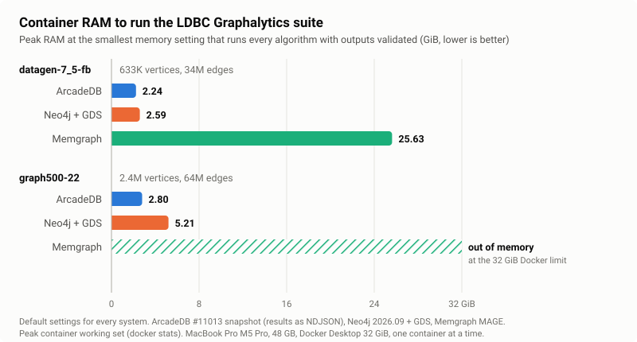

# Minimum memory after #11013, and how far settings stretch it on graph500-22 (2026-10-30)

Re-measure of [results-min-memory-2026-10-30.md](results-min-memory-2026-10-30.md) on ArcadeDB `main` @ `21d2a0eb38` (the merge of
[#11013](https://github.com/ArcadeData/arcadedb/pull/11013), which fixes [#11011](https://github.com/ArcadeData/arcadedb/issues/11011)),
then a search for the smallest heap that runs graph500-22 by changing settings. Same method: the JVM heap is lowered until a run fails;
the container is not capped, so its peak working set is the RAM really used. Memory only: part of the re-measure ran on battery, so no
time from this file is compared with a published one (the engine compute times at 12 GB, even on battery, match the published ones:
PageRank 0.112 s, LCC 2.48 s on datagen).

Machine: MacBook Pro M5 Pro, 48 GB, Docker Desktop 32 GB, one container at a time. Image `arcadedb-bench:21d2a0eb38-jvm`
(`4694206fb3c2`, 26.11.1-SNAPSHOT, Temurin 25, ZGC unless noted), built with `mvn package -DskipTests -pl package -am` and
`docker build -f package/src/main/docker/Dockerfile package/target/arcadedb-26.11.1-SNAPSHOT.dir`. Neo4j numbers are from the run of
2026-10-29/30 (Neo4j 2026.09 + GDS, unchanged). Raw data: `weekly-results/20261030-min-heap-11013/` and
`weekly-results/20261030-stretch-graph500/` (`<config>/min-heap.json`, one log per run).

## Result with default settings

| | ArcadeDB 26.10.2 | **ArcadeDB #11013** | Neo4j + GDS |
|---|---|---|---|
| datagen-7_5-fb, with the view: smallest heap / container peak | 3 GB / 3.30 GiB | **2 GB / 2.24 GiB** | 1.5 GB / 2.59 GiB |
| graph500-22, with the view: smallest heap / container peak | 4 GB / 4.38 GiB | **3 GB / 3.31 GiB** | 4 GB / 5.21 GiB |
| datagen, at rest, 12 GB heap: live heap / container footprint | 2,170 / ~2,490 MB | **705 / ~920 MB** | 775 / ~2,000 MB |
| datagen, no view, 2 GB heap, default algorithm budget | WCC, BFS, LCC refused | **all 6 pass**, 2.39 GiB peak | n/a |

Every passing run validated against the LDBC reference outputs. In container RAM ArcadeDB now needs less than Neo4j on both graphs
(0.86x on datagen, 0.64x on graph500) and about 0.46x at rest. Neo4j's heap alone understates it: its 512 MiB page cache is off-heap,
ArcadeDB's is inside the heap.

The #11011 issues, checked:

1. Restoring the view: one heap step lower on both graphs; the view's live heap on graph500 went from 2.28 to 1.40 GiB.
2. A failed restore now ends `FAILED` in 18-33 s (it stayed `BUILDING` beyond 900 s), with the cause in `buildError` and a SEVERE line in
   the server log file (`ran out of heap (max heap 1.50GB, page cache 384.00MB). The view is FAILED. Raise the heap (-Xmx) or lower
   arcadedb.maxPageRAM, then rebuild it`). The driver now stops waiting on `FAILED`.
3. The algorithm budget: without the view at 2 GB all six algorithms run with the defaults (140-270 s each, live heap at most 855 MB).
4. The resting footprint: 2.7x smaller with the defaults (the build no longer leaves the pages it read in the cache).
5. A clean stop now persists the view (1.36 GB file on graph500) and the next start reuses it: `READY` 2 s after the server answers,
   against 38-46 s for a rebuild, with no `CSR build started` in the log.

## graph500-22: every attempt below the 3 GB default floor

"Compute only" skips the full-output export (`BENCH_NO_VALIDATE=1`, `min_heap.py --compute-only`): an algorithm passes when it returns a
number and its summary check (vertex count and an aggregate of the output) is ok. Live heap is the maximum over the probes.

| Configuration | Heap | Result | Container peak (GiB) | Live heap (GiB) |
|---|---|---|---:|---:|
| defaults, view rebuilt, full outputs | 3 GB | pass | 3.31 | 1.40 |
| defaults, view rebuilt, full outputs | 2 GB | view `FAILED` (rebuild out of heap) | n/a | n/a |
| S1: page cache 128 MB, view rebuilt, full outputs | 2.5 GB | algorithms pass; PR, WCC, LCC, CDLP export out of heap (BFS exported) | 2.81 | 1.40 |
| S2: page cache 128 MB, persisted view reused, full outputs | 2.5 GB | view ready in 2 s; same 4 exports out of heap | 2.80 | 1.40 |
| C1: defaults, view rebuilt, compute only | 2.5 GB | pass | 2.80 | 1.40 |
| C1 | 2 GB | view `FAILED` (rebuild out of heap) | n/a | n/a |
| C2: page cache 128 MB, view rebuilt, compute only | 2 GB | pass | 2.26 | 1.40 |
| C2 | 1.75 GB | view `FAILED` (rebuild out of heap) | n/a | n/a |
| C3: page cache 128 MB, persisted view reused, compute only | 2 GB | pass | 2.28 | 1.40 |
| C3 | 1.75 GB | LCC out of heap; PR, WCC, BFS, CDLP pass | 1.99 | 1.40 |
| C4: as C3 with G1 instead of ZGC | 2 GB | pass | 2.20 | 1.40 |
| C4 | 1.75 GB | LCC out of heap; the other four pass | 1.96 | 1.40 |
| C5: as C3, view without the edge weights | 1.75 GB | pass | 2.01 | 0.67 |
| C5 | 1.5 GB | pass | 1.73 | 0.67 |
| C5 | 1.25 GB | **pass** | **1.47** | 0.67 |
| C5 | 1 GB | LCC out of heap; the other four pass | 1.21 | 0.67 |

### The same with the outputs streamed (NDJSON)

The drivers now read every row-returning call as NDJSON (`Accept: application/x-ndjson`, `shared/arcadedb_http.py`), so the server
never holds a whole result. Full benchmark again, every output exported and validated (`weekly-results/20261030-ndjson/`):

| Configuration | Heap | Result | Container peak (GiB) | Live heap (GiB) |
|---|---|---|---:|---:|
| datagen, 12 GB (sanity) | 12 GB | pass, 6/6 valid; compute times as published (PR 0.108, LCC 2.36, CDLP 1.34 s) | n/a | n/a |
| F1: defaults, view rebuilt | 2.5 GB | **pass** (failed on the export before) | 2.80 | 1.40 |
| F1 | 2 GB | view `FAILED` (rebuild out of heap) | n/a | n/a |
| F2: page cache 128 MB, persisted view reused | 2 GB | **pass** | 2.24 | 1.40 |
| F2 | 1.75 GB | LCC out of heap | 1.99 | 1.40 |
| F3: as F2, view without the edge weights | 1.5 GB | pass | 1.73 | 0.68 |
| F3 | 1.25 GB | **pass** | 1.46 | 0.68 |
| F3 | 1 GB | LCC out of heap | 1.21 | 0.68 |

Streaming costs no heap: every full-benchmark floor equals the compute-only one, so the algorithm procedures do not materialize their
outputs either. The full graph500-22 benchmark, outputs included, now needs 2.5 GB with the defaults and 2 GB with a 128 MB page
cache and a clean restart, against Neo4j's 4 GB.

So the floor on graph500-22 is, by what limits it:

- **3 GB with the full outputs over buffered JSON**, whatever the settings: the HTTP response of a 2.4M-row result is built in the heap
  before it is sent (about 1 GB). Gone with NDJSON (above). Neo4j fails its export step at 3 GB (GDS refuses to stream the full
  outputs).
- **2.5 GB compute only with the defaults**, **2 GB** with a 128 MB page cache: below that the view rebuild runs out of heap.
- **2 GB with the persisted view** (no rebuild): below that LCC's working memory does not fit next to the 1.40 GiB view. The collector
  does not matter (G1 fails the same step as ZGC).
- **1.25 GB (1.47 GiB container peak) with a view that leaves out the edge weights**, which none of the five graph500 algorithms read
  (SSSP, the only weighted one, is skipped on graph500). LCC is again the limit one step lower. This is a stretch, not the comparison:
  Neo4j's projection also carries the weights (`properties: 'weight'`) and could drop them as well.

## For ArcadeDB

1. **Large results need NDJSON.** The buffered `application/json` response holds the whole result in the heap (about 1 GB for 2.4M
   rows); the NDJSON encoding (`Accept: application/x-ndjson`, #7306, since 26.3.2) streams it at no measurable heap cost. Clients
   reading large results should be pointed to it in the docs, and the buffered response could refuse or warn above a size.
2. **Edge properties cost more than the graph.** On graph500-22 the `WEIGHT` column takes about 740 MB (1,333 MB live with it, 592 MB
   without; persisted file 1.36 GB against 0.58 GB), about 11.6 bytes per edge for 64M edges, more than the whole CSR of both directions.
   Storing a weight as a float, once instead of per direction, or only when an algorithm needs it, would roughly halve a weighted view.
3. **LCC's working memory is now the floor** with a persisted view (it fails at 1.75 GB with the weights and at 1 GB without).
4. **The rebuild still needs more than the view**: the persisted view runs at 2 GB where a rebuild needs 2.5 GB (default page cache) or
   2 GB (128 MB). A deployment that restarts cleanly reuses the persisted CSR and avoids it.

## Reproduce

```bash
export ARCADEDB_IMAGE=arcadedb-bench:21d2a0eb38-jvm
python3 scripts/min_heap.py --out <dir>/datagen-7_5-fb --vendors arcadedb --heaps 3g 2g 1536m
python3 scripts/min_heap.py --out <dir>/graph500 --dataset graph500-22-w --vendors arcadedb --heaps 4g 3g 2g
ARCADEDB_SERVER_FLAGS="-Darcadedb.maxPageRAM=128" python3 scripts/min_heap.py --out <dir>/c2 --dataset graph500-22-w \
  --vendors arcadedb --heaps 2g 1792m --expect pagerank,wcc,bfs,lcc,cdlp --compute-only
# persisted view: one run with ARCADEDB_CLEAN_STOP=1 at 3g writes databases/bench/gav-benchmark.csr, then the same with the ladder;
# ARCADEDB_GC=-XX:+UseG1GC replaces ZGC; the weightless view = edgePropertyFilter removed from the view in schema.json
```

## RAM for the same workload: ArcadeDB, Neo4j and Memgraph

**On the same workload, the LDBC Graphalytics suite on the same graphs with every algorithm run and its full output validated against
the LDBC reference, ArcadeDB needs 2.24 GiB of container RAM on datagen-7_5-fb and 2.80 GiB on graph500-22 with its default
settings. That is 14% less than Neo4j + GDS on the smaller graph (2.59 GiB) and 46% less on the larger one (5.21 GiB), and 11x less
than Memgraph on datagen-7_5-fb (25.63 GiB); Memgraph does not complete graph500-22 within the 32 GiB Docker limit.** ArcadeDB is
also the fastest of the three on every algorithm at these settings (its speed at the minimum heap equals the 12 GB one).



| Container RAM (GiB), default settings | datagen-7_5-fb (633K vertices, 34M edges) | graph500-22 (2.4M vertices, 64M edges) |
|---|---:|---:|
| **ArcadeDB** (#11013 snapshot, results as NDJSON) | **2.24** (2 GB heap) | **2.80** (2.5 GB heap) |
| Neo4j 2026.09 + GDS | 2.59 (1.5 GB heap) | 5.21 (4 GB heap) |
| Memgraph (MAGE) | 25.63 (no limit; fails at 24 GB) | out of memory at 32 GiB |
| ArcadeDB / Neo4j | 0.86x | 0.54x |
| ArcadeDB / Memgraph | 0.09x | n/a |

How to read it:

- **The number is the whole container**, the peak working set from `docker stats` at the smallest memory setting that still runs every
  algorithm and validates its output. It counts the JVM heap and everything outside it (Neo4j keeps its 512 MiB page cache off-heap,
  ArcadeDB inside the heap), so it is the RAM a deployment has to provide. A heap size alone would flatter Neo4j.
- **Default settings for every system**: no vendor was tuned. With two settings (a 128 MB page cache and a clean restart, which reuses
  the persisted view) ArcadeDB runs the full graph500-22 suite in 2.24 GiB, 0.43x of Neo4j; Neo4j was not tuned in the same way.
- **At rest**, with the graph and its analytical structure loaded on datagen-7_5-fb, ArcadeDB holds about 0.92 GiB, Neo4j about 2.0 GiB
  (`results-jvm-memory-2026-10-29.md`) and Memgraph 8.1 GiB, which peaks at 24-26 GiB during WCC.
- Memgraph keeps the graph and the algorithm state in memory by design; its datagen-7_5-fb times from these runs are swap-affected and
  not compared, its RAM is.
